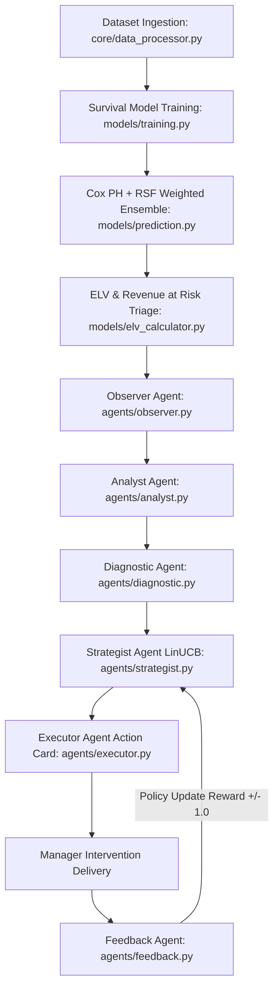

# Nexus AI — Autonomous Attrition & Retention Architecture

**Nexus AI** is a production-grade Survival Analysis and Explainable AI (XAI) framework for autonomous employee attrition forecasting, monetary risk triage, and closed-loop retention intervention.

---

## 📁 Modular Directory Architecture

```
Intern_task-1/
│
├── 📂 datasets/                  # Benchmark & uploaded employee datasets
│   ├── ibm/                     # Primary dataset: IBM HR Analytics (n=1,470)
│   └── healthcare/              # Validation dataset: Watson Healthcare (n=1,676)
│
├── 📂 frontend/                  # User Interface Layer
│   ├── templates/
│   │   ├── dashboard.html       # Primary SPA: React 18 + Tailwind + Chart.js (Light/Dark)
│   │   └── legacy_index.html    # Original dashboard template
│   └── static/
│       ├── css/style.css        # Core styling, tokens, and animations
│       └── js/app.js            # Client-side state handlers
│
├── 📂 backend/                   # FastAPI Server & REST API Layer
│   ├── server.py                # FastAPI app entrypoint, CORS & static mounting
│   ├── state.py                 # Central in-memory runtime session store
│   ├── schemas.py               # Pydantic request & response models
│   └── routes/                  # Modular API Route Controllers
│       ├── dataset.py           # /api/upload, /api/load-preset, /api/generate-sample
│       ├── training.py          # /api/train (Cox PH + RSF ensemble pipeline)
│       ├── analytics.py         # /api/analytics, /api/triage, /api/employee/{id}
│       ├── agents.py            # /api/agent/run, /api/agent/feedback
│       └── ablation.py          # /api/ablation, /api/benchmark/dual
│
├── 📂 core/                      # Core Data Ingestion & Processing Layer
│   ├── data_processor.py        # Schema normalization, validation & survival encoding
│   ├── dataset_generator.py     # Synthetic dataset generator
│   ├── persistence.py           # Model artifact serialization & loading (joblib)
│   └── report_generator.py      # Automated HTML & JSON evaluation reporting
│
├── 📂 models/                    # Survival ML & Economic Triage Models
│   ├── survival_models.py       # Cox PH, Random Survival Forest, Kaplan-Meier
│   ├── training.py              # Stratified split, tuning, evaluation & predictions
│   ├── prediction.py            # Weighted ensemble curves S(t), hazard scores
│   ├── validation.py            # Stratified K-fold cross-validation
│   ├── metrics.py               # C-index, IBS (Brier score), Calibration, Hazard ratios
│   ├── elv_calculator.py        # ELV, Confidence-weighted Revenue at Risk, Recall@K
│   ├── explainability.py        # TreeSHAP values, waterfall plots & feature importance
│   ├── llm_diagnostics.py       # SHAP-to-natural language diagnostic generator
│   └── ablation.py              # Section 10 scientific ablation study suite
│
├── 📂 agents/                    # Autonomous 6-Stage Multi-Agent System
│   ├── observer.py              # Agent 1: Telemetry & roster ingestion monitor
│   ├── analyst.py               # Agent 2: Financial exposure & ELV risk triage
│   ├── diagnostic.py            # Agent 3: SHAP-to-LLM narrative synthesizer
│   ├── strategist.py            # Agent 4: LinUCB Contextual Bandit policy selector
│   ├── executor.py              # Agent 5: Manager Action Card dispatcher
│   ├── feedback.py              # Agent 6: 30-day intervention reward updater
│   └── pipeline.py              # NexusMultiAgentPipeline orchestrator
│
├── 📂 outputs/                   # Saved model binaries, JSON metrics & reports
├── 📄 main.py                    # Unified application launcher (port 8000)
├── 📄 requirements.txt           # Python dependency requirements
└── 📄 README.md                  # System architecture & documentation
```

---

## 🚀 Quick Start Guide

### 1. Launch Server
```powershell
python main.py
```
*(Or launch directly via uvicorn:)*
```powershell
uvicorn backend.server:app --reload --port 8000
```

### 2. Access Web Interface & API Docs
- **Interactive Web Dashboard**: [`http://localhost:8000`](http://localhost:8000)
- **Interactive Swagger API Docs**: [`http://localhost:8000/docs`](http://localhost:8000/docs)
- **ReDoc API Documentation**: [`http://localhost:8000/redoc`](http://localhost:8000/redoc)

---

## 🔄 End-to-End Execution Flow


